# The prompts that shaped the game

*Making Retro del Sol · A lesson in giving direction*

A seaside town became a place to walk, drive and sail with other people. These fifteen moments show how the requests changed as there was more to see and play.

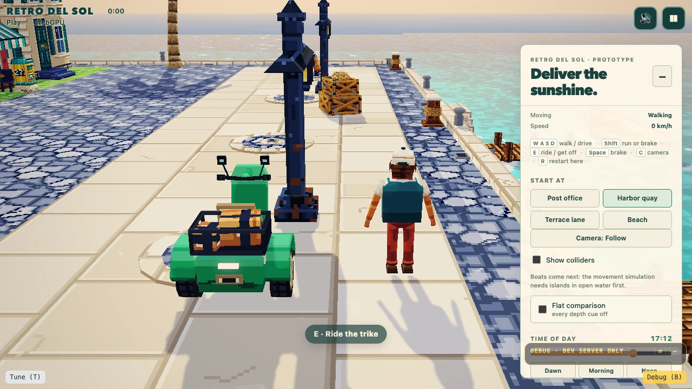

The same lesson is also a web page, with the clips playing in place: [chongdashu.github.io/retro-del-sol-resources/prompts.html](https://chongdashu.github.io/retro-del-sol-resources/prompts.html).

The quotes are excerpts from the original messages to the coding agent, with spelling preserved. Each round also involved implementation and testing.

## Contents

1. [Ask to see the game](#1-ask-to-see-the-game)
2. [Turn the idea into a place](#2-turn-the-idea-into-a-place)
3. [Make a place to try things](#3-make-a-place-to-try-things)
4. [Say what looks wrong](#4-say-what-looks-wrong)
5. [Say what should touch](#5-say-what-should-touch)
6. [Ask for a bigger, bouncier move](#6-ask-for-a-bigger-bouncier-move)
7. [Write the action in order](#7-write-the-action-in-order)
8. [Show where land meets water](#8-show-where-land-meets-water)
9. [Ask for dials, not one answer](#9-ask-for-dials-not-one-answer)
10. [Give the journey somewhere to go](#10-give-the-journey-somewhere-to-go)
11. [Say what you couldn't do](#11-say-what-you-couldnt-do)
12. [Decide what players share](#12-decide-what-players-share)
13. [Help the player see what to do](#13-help-the-player-see-what-to-do)
14. [Let players put themselves in](#14-let-players-put-themselves-in)
15. [Give a key a new job, with a limit](#15-give-a-key-a-new-job-with-a-limit)

[Your next prompt](#your-next-prompt)

## 1. Ask to see the game

*The project began with four possible games. Asking for a picture of play made it easier to choose the kind of world to build.*

The prompt:

> we want these to not look like box art or concept art, but rather, reflect what in-game visuals would look like.\
> this will set both the creative and art direction of the game we build.\
> think about 4 distinct premises of the game, and then generate 4 representatives mock ups.

The seaside courier idea, first called Tidepost, became Retro del Sol. Its little streets, warm colours and delivery vehicle gave the later work a direction.

#### Try this in your own project

Ask for a picture that shows what the player will actually do. Use it to choose a direction before building the whole game.

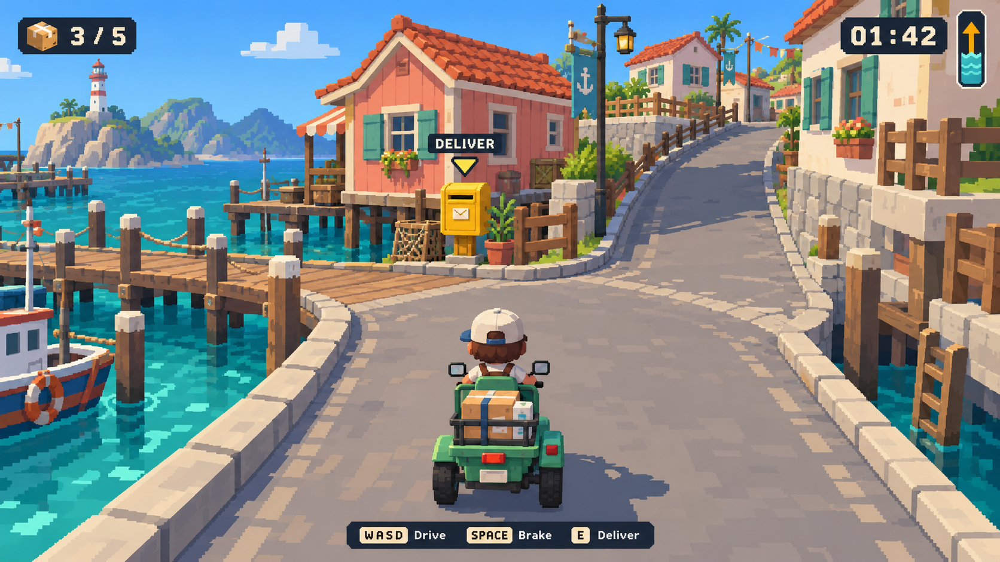
*Chosen direction: an early generated mockup, not a screenshot of the game.*

## 2. Turn the idea into a place

*Once the seaside setting was chosen, the next request described the experience: a world large enough to drive around.*

The prompt:

> I think if we can go for a well built out world big enough to drive around it would already be a great showcase.\
> could make it multiplayer as well.

The longer request split the work into the town and props, the courier, and the vehicle. Reference pictures helped them belong together. Retro Diffusion made the models, which were then inspected and adjusted in Blender, a 3D editor.

#### Try this in your own project

Give the agent a shared setting, then name the pieces it needs to make. Keep a small place where you can inspect them together.

One example, asking Retro Diffusion for a bench. The agent also wrote prompts for individual objects; this one describes the bench and asks for it on its own:

> Wooden park bench matching the reference: three seat slats, two back slats, chunky dark navy iron legs with square feet. Single freestanding bench, no ground or other objects. Coarse pixel textures.

This is the exact asset-generation prompt sent to Retro Diffusion, separate from the instructions to the coding agent. The bench is in [models/](models/README.md).

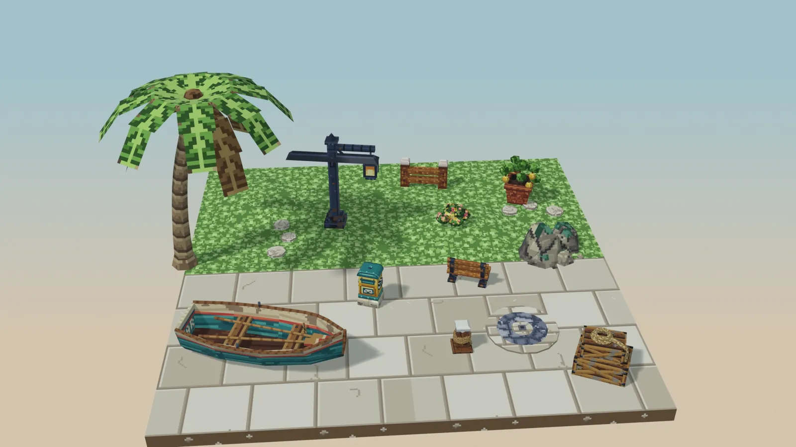
*Generated props, arranged together for review in Blender.*

## 3. Make a place to try things

*A beautiful town would not tell us whether walking and driving felt good. The next useful place was a simple practice area.*

The prompt:

> let's focus on a new scene that is a plain gym for testing things like the walking and entering the trike and then testing the trike movement.

The movement gym gave the courier room to walk, mount the trike and drive through obstacles. The camera could be tested there too. A follow-up rule removed the countdown so testing started immediately.

#### Try this in your own project

Ask for somewhere small and easy to test one interaction. You can spot problems sooner when the scenery is simple.

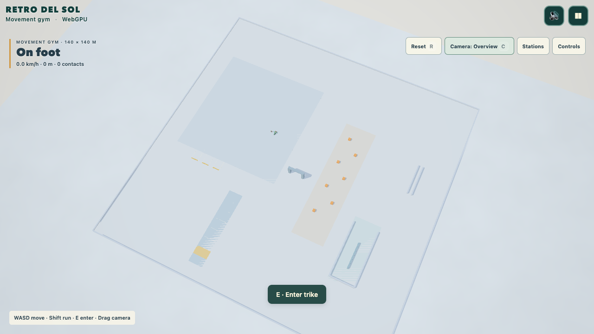
*Actual game capture: the practice area used to test movement.*

## 4. Say what looks wrong

*The character could move, but the walk felt stiff. This feedback named the visible problems and the feeling to aim for.*

The prompt:

> his walk feels like his legs can't bend at his knees\
> his elbows too, are not bending much\
> his up/down motion is very jittery
>
> i think we should focus on exaggerated, whimsical, clearly visible movements

The walk and run were reworked with clearer knee and elbow bends and a smoother bounce. The clips below show the earlier motion and the revised motion in the game.

#### Try this in your own project

Point to the body part, movement or moment that feels wrong. Add a few words about the feeling you want.

[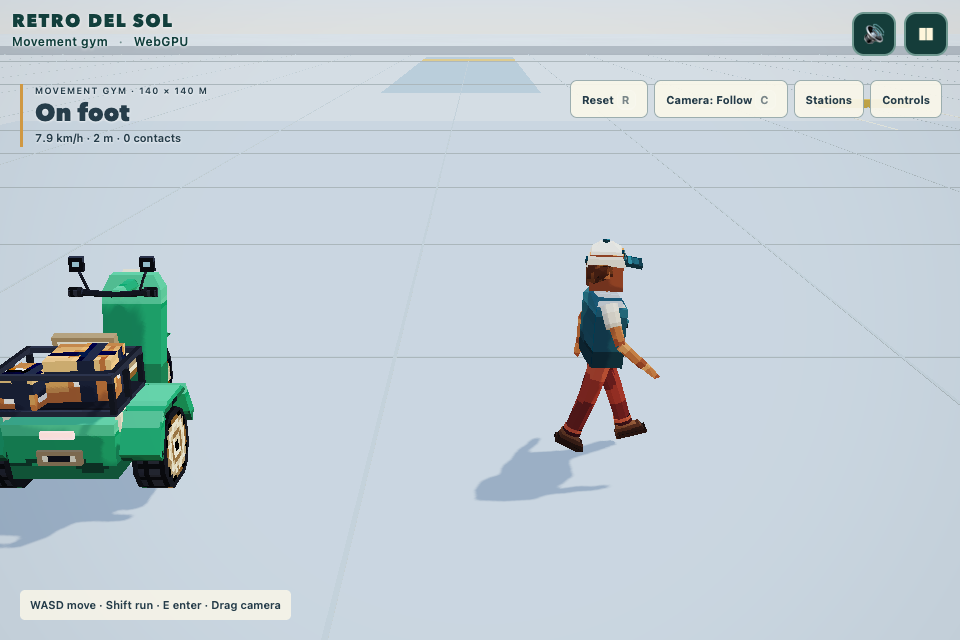](media/20261020-110401-courier-motion-review/before-walk-clip.mp4)
*Before: the earlier walk in the game.* (Click the picture for the clip.)

[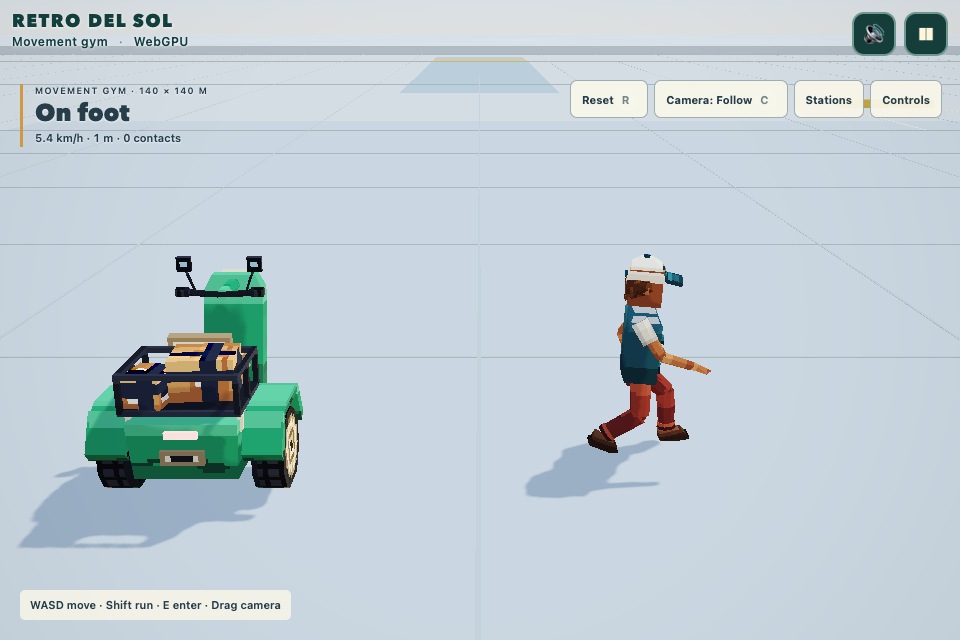](media/20261020-110401-courier-motion-review/after-walk-run-clip.mp4)
*After: revised walking and running.* (Click the picture for the clip.)

## 5. Say what should touch

*On the trike, the courier's hands floated near the handlebars and stayed still while the trike turned.*

The prompt:

> when he goes left and right on the vehicle, his hands should attach to the steering wheel and turn left and right too

Both hands now reach for grip points on the handlebars and follow them as the trike steers. The arms bend to keep the hands in place, and the grip blends in as he climbs on and lets go as he gets off.

#### Try this in your own project

When a character uses an object, name the parts that should touch and what should move together. "Hands on the handlebars, turning with them" is enough for the agent to work from.

[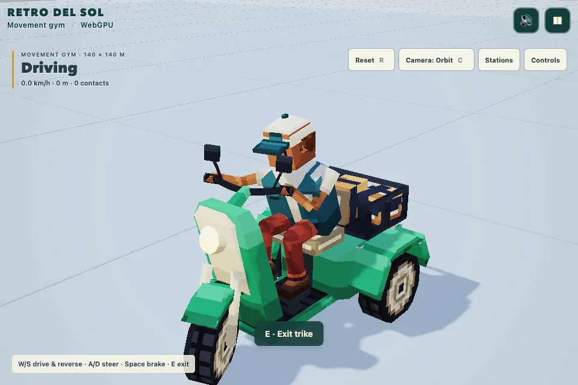](media/20261020-113032-courier-arm-steering/steering-final.mp4)
*Actual game capture: hands on the handlebars, turning with the steering.* (Click the picture for the clip.)

## 6. Ask for a bigger, bouncier move

*Getting on the trike was a quick slide into the seat. It worked, but it had no character.*

The prompt:

> can we have an exagerrated animation of him jumping into the bike, with it bobbing as he lands in

A later correction:

> his jump out of the car also needs the same fix

The courier now crouches, hops high and drops into the seat, and the trike dips and bounces back as he lands. A short follow-up gave getting off the same treatment: he stands, crouches and jumps clear while the trike settles.

#### Try this in your own project

If a move feels flat, ask for it to be exaggerated and say how the world should react. Once one move feels right, "the same fix" is a quick way to ask for it elsewhere.

[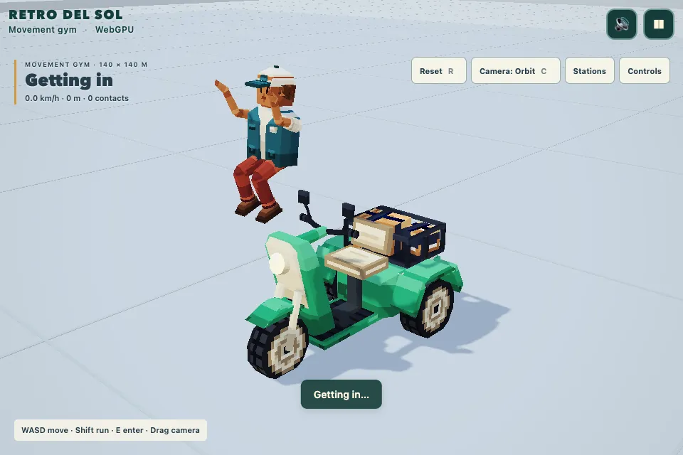](media/20261020-114935-courier-jump-mount/jump-mount-final.mp4)
*Getting on: a big hop, and the trike bobs as he lands.* (Click the picture for the clip.)

[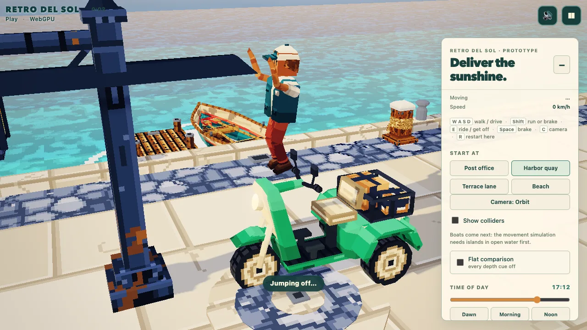](media/20261020-125942-trike-disembark/town-stand-jump.mp4)
*Getting off: stand, crouch and jump clear.* (Click the picture for the clip.)

## 7. Write the action in order

*Getting out of the boat looked weightless. The correction described a sequence anyone could imagine.*

The prompt:

> The jumping out of the boat needs work, he sort of floats out from seating. He should stand up, with the boat rocking a bit, then jump out with the boat rocking more.

The courier now stands, prepares to jump and leaves the boat. The boat reacts as his weight shifts, then rocks more as he jumps away.

#### Try this in your own project

Describe what happens first, what happens next, and how nearby objects should react. This gives the agent a clear motion to work toward.

[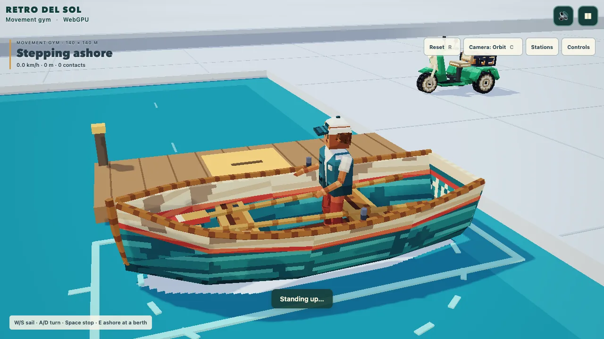](media/20261020-123611-boat-disembark/stand-jump-recoil.mp4)
*Actual game capture: the revised boat exit.* (Click the picture for the clip.)

## 8. Show where land meets water

*The courier could walk and the boat could sail, but nothing joined the two. There had to be places to step from land into a boat and back.*

The prompt:

> this needs 'prefabs' to indicate the water &lt;> land &lt;> boat connection - if u know what i mean, so as to allow getting on and off at regions

A later correction:

> we need an action button when the player is in a boat hotspot - right now it's not clear exactly if it;s in the hotspot

Piers became one reusable piece with a spot to stand and a berth for the boat, used both for what you see and for the rules of boarding. Much later, a play session showed the spot was hard to find, so a ring now marks it on the deck and a Board button appears over the boat when you stand in it.

#### Try this in your own project

Name the places where the rules change, like the edge between land and water, and ask for one reusable piece that marks them. Then check that a player can actually see where they are.

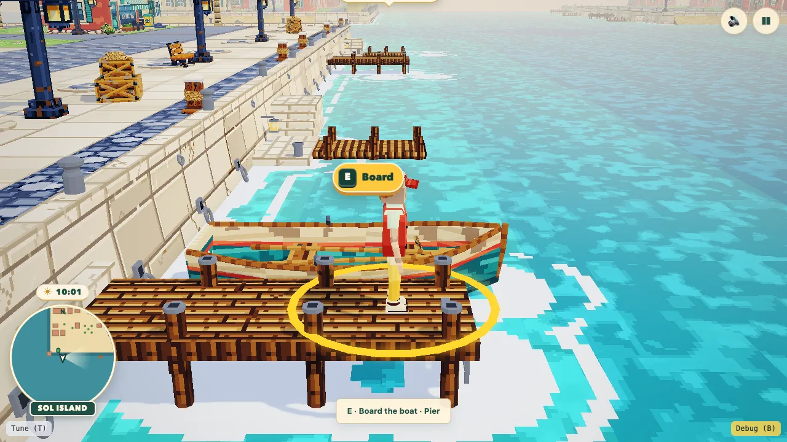
*Standing in the boarding spot: the ring turns gold and the Board button appears.*

## 9. Ask for dials, not one answer

*The town looked flat. Nobody knew yet which lighting and effects would make it feel deep.*

The prompt:

> I want to see the effect of lighting, post processing, fog, bloom, etc. in order to see what we can do to bring the level to be less 'flat' and more 'depth'.

A later correction:

> we can do better with the water\
> what are some ways to get water depth, froth, motion, height, etc.

The town scene gained sliders and switches for time of day, fog, haze, bloom, shadows, outlines and more, with a flat comparison and a reset. A second pass gave the sea depth colour, foam along the shore, reflections and two layers of moving water.

#### Try this in your own project

When you can't say what "better" looks like yet, ask for sliders and switches so you can compare options yourself. Asking for ways to improve something often gives you a menu of ideas to pick from.

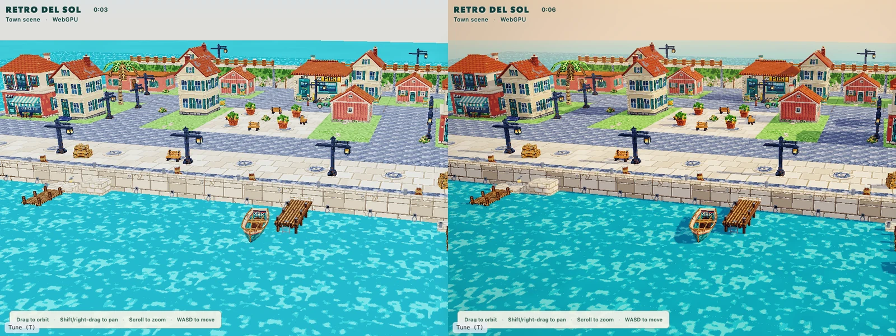
*The same harbour: flat, then with lighting and depth effects.*

[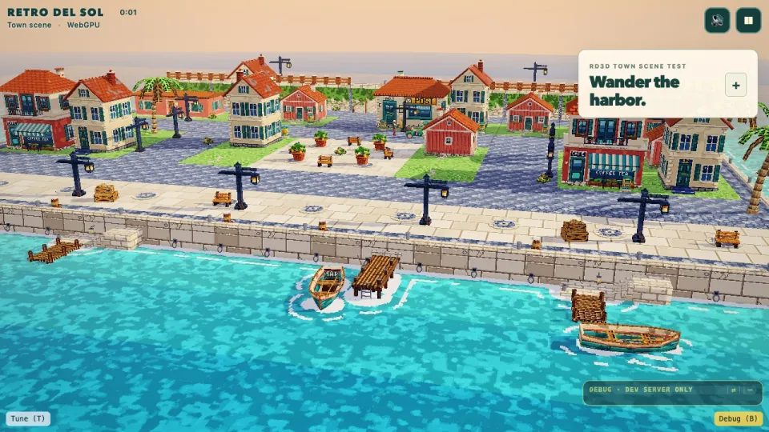](media/20261020-110416-town-sea/sea-harbor.mp4)
*The reworked water in motion.* (Click the picture for the clip.)

## 10. Give the journey somewhere to go

*A bigger world needed more than repeating buildings. The player had to be able to travel through it.*

The prompt:

> if we want to have a large world that multiple people can walk around and drive around,  but obviously there's a rendering limit, what should we do?

A world test explored loading the area near the player. A later playable version connected sixteen islands with boat journeys. The courier could leave the home pier, cross the water and go ashore on another island.

#### Try this in your own project

Explain what the extra space is for. Ask to test a real journey through it, including getting there and getting back.

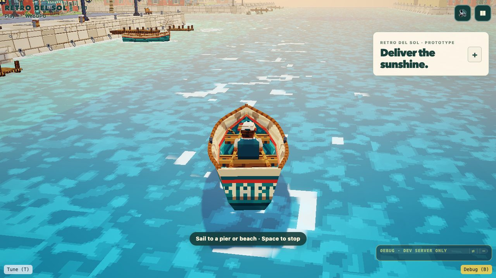
*Later game capture: sailing between islands. Development controls are visible.*

## 11. Say what you couldn't do

*The islands were connected by boat, but while playing, the way off an island wasn't there or wasn't visible.*

The prompt:

> i can't seem to find a path from the my island to the next.

A later correction:

> right now it's hard to locate or see the docks because they are a level below, someone might think there is no way off the island

The first report uncovered a real gap: four islands had no boat at all. Every pier now has one. The second report led to signs above the piers showing how many boats are free and how far away, plus a pointer at the edge of the screen when no pier is in view.

#### Try this in your own project

Describe what you tried and couldn't do, in plain words. A report like "I can't find a way off this island" lets the agent look for the cause, which may be different from what you'd guess.

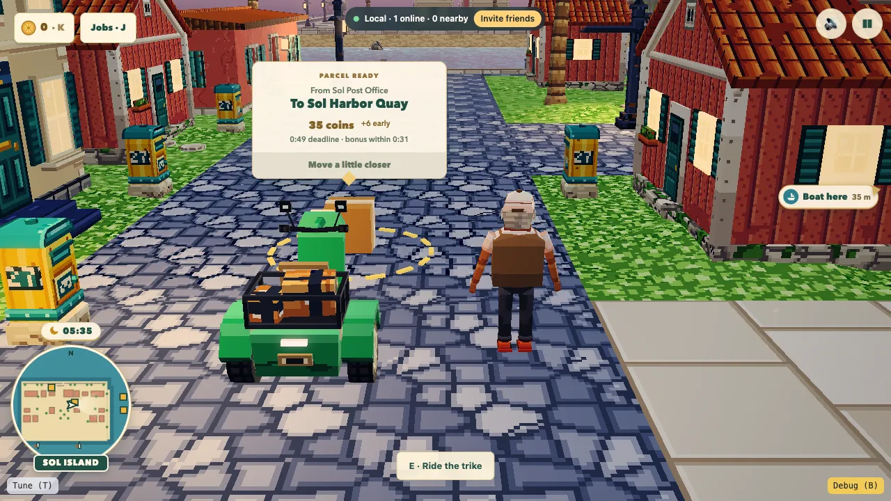
*A sign over the pier shows a free boat 35 m away; the minimap names the island.*

## 12. Decide what players share

*The next step brought other players into the world. A second prompt corrected an assumption about who owned the vehicles.*

The prompt:

> ok now let's make this multplayer, we should have a few spawn points around the world\
> it is a single persistent world

A later correction:

> wdym by each player has their own trike and boat, we should not have that, it should be a fixed amount.

The first version created vehicles for each person. The correction made them a shared fleet: get off a trike and it stays parked for someone else to use.

#### Try this in your own project

Spell out which things belong to a player and which belong to the world. Check what happens when two people want the same thing.

[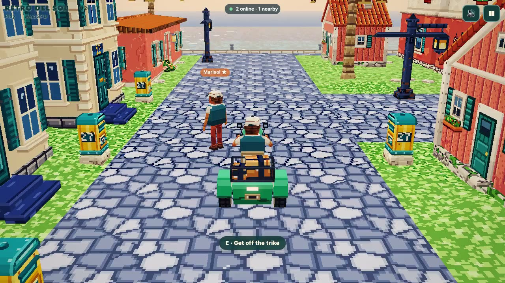](media/2026-10-20-multiplayer-broll/06-one-shared-trike.mp4)
*Recorded multiplayer play: one trike shared between players.* (Click the picture for the clip.)

## 13. Help the player see what to do

*Deliveries worked, but too much attention went to buttons and status text. The request brought directions into the world itself.*

The prompt:

> There should be a in-game visual guide trail that guides a path toward the location. The player hence can easily know where to go. This is unobtrusive.

A later correction:

> thanks the receipt ends up blocking the view so show it on the side

A trail guides the courier to the destination, via a boat and pier when needed. A receipt confirms the handover. Playing again revealed that the receipt covered too much of the scene, so it moved to the side.

#### Try this in your own project

Describe the information a player needs at the moment they need it. Then play again and check whether the new feedback gets in the way.

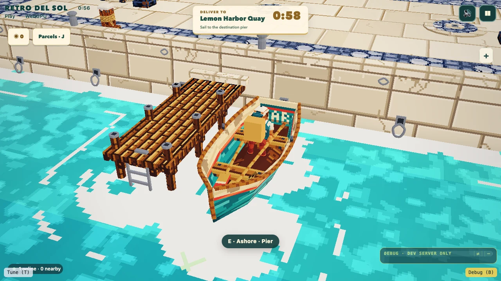
*Actual game capture: the delivery trail continues across the water.*

## 14. Let players put themselves in

*Everyone started as the same courier. Players needed a simple way to make the character theirs before playing.*

The prompt:

> now we want to be able to have a bit of customisation for users before they enter the game, so their character will be on screen and then they can click customise before going in. simple set of options, with a random button.

A later correction:

> we should have the characer on the right already with the customise under him\
> player name under, with the squiggly lines underneath to ineidcate it can be changed.

The menu now shows your courier, with Customise and your name underneath. Customise opens one row of colours per part, plus Random and Original. Other players see your colours too.

#### Try this in your own project

Describe what the player sees and the few choices they get. A Random button helps people who don't want to decide, and saying where things sit on screen saves a round of changes.

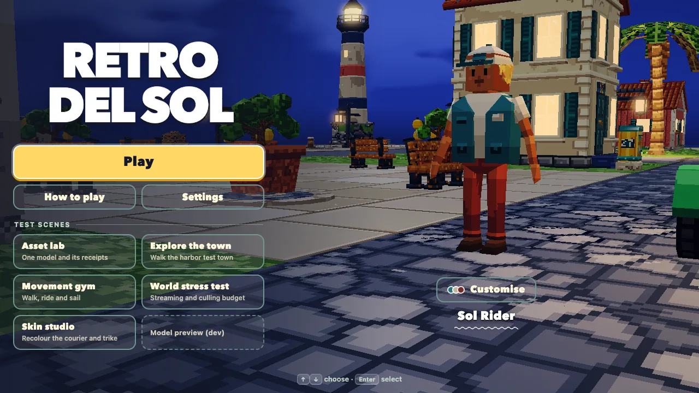
*The menu: your courier, Customise, and your name.*

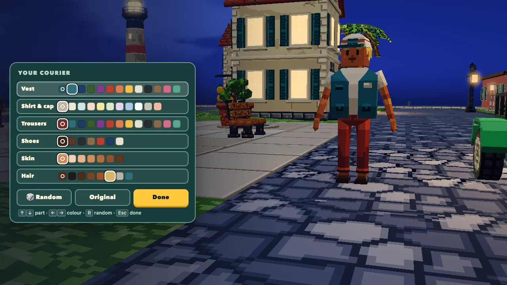
*Customise: a row of colours for each part, plus Random.*

## 15. Give a key a new job, with a limit

*In the trike and the boat, Shift only slowed you down. Travel between islands could feel slow.*

The prompt:

> shift when in car should be an boost accelerator but has a cooldown / shift when in boat same thing

Pressing Shift while riding forward now gives a short burst of speed, then a few seconds to recharge. A small meter shows when it is ready, and on phones the Run button becomes Boost.

#### Try this in your own project

Say the new rule and its limit in the same breath, like "a boost, but with a cooldown". The limit is what keeps a fun idea from taking over the game.

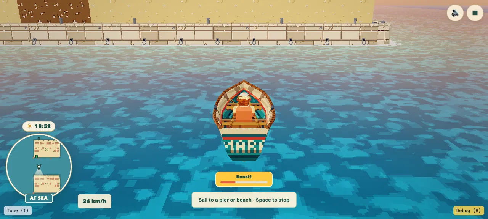
*Boosting the boat: the meter drains, then recharges.*

## Your next prompt

*Give it something you can try.*

Start with the experience you want. Once you have a version to play, describe a specific moment that needs work and ask to see the change.

A fill-in template inspired by the examples above (not an original project prompt):

```text
I want the player to feel [feeling] while they [main action].
First, show me [a small scene or example] so I can decide on the direction.

When I tried it, I noticed [specific problem].
It should [describe the action or response you want].
Show me the revised version so I can try it again.
```

---

Retro del Sol, recorded project work from 20 and 21 October 2026. Images marked "mockup" show the intended direction; game captures show the work at that stage. The full build, with its source, records and journey, is shared with [VibeGameDev](https://www.vibegamedev.com/) members.
